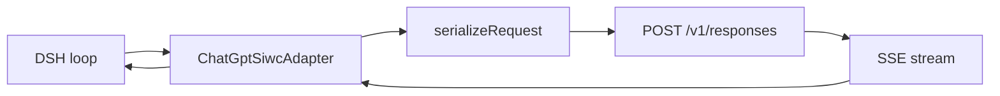

<!--
wiki:
  project: dsh-chatgpt-siwc
  repo: calisweetleaf/dsh-chatgpt-swic
  lang: en                      # canonical source language; translations point back here
  source_commit: 02013f245d5b8395ac5164ca4d4e9f57932317ac
  updated: 2026-11-11
  translations:
    zh-CN: WIKI.zh-CN.md        # each translation stores the sha256 of this file's body in its own header
  publish_as: Home.md           # name inside calisweetleaf/dsh-chatgpt-swic.wiki.git (zh-CN -> Home-zh-CN.md); sync rewrites WIKI*.md links to wiki page names
  rc5_note: facts about 0.2.1-rc.5 + session-id patch were verified against siwc-rc5-session-id.zip (md5 c82d2197bad82455dd0e4c45193b6b8a), not against a pushed commit — rc.5 is not pushed or published yet (see Status and roadmap).
Rules: every number, benchmark, and capability claim carries an evidence pointer
(file:line, test name, run id, or release asset). No pointer, no claim. Delete any
section that does not answer a reader question for this repo.
-->

# dsh-chatgpt-siwc

**English** | [简体中文](WIKI.zh-CN.md)

A DeepSeek Harness (DSH) plugin that serves model calls from your own ChatGPT Plus/Pro plan through the official Sign in with ChatGPT (SIWC) flow: dynamic OAuth registration, then the public Responses API with the issued OAuth access token. It is for DSH users who want their ChatGPT subscription — not an API key, not a Codex login — as a provider inside the harness. The one thing it does that its neighbours do not: it treats the plan route as a contract to be enforced in code, not a vibe — live model discovery with no static list, per-model efforts taken from the catalog, and deterministic prompt-cache behaviour (a `session-id` header carrying the same value as `prompt_cache_key`, a system prompt that stops rewriting itself mid-conversation, and encrypted reasoning replayed instead of re-reasoned).

| | |
| --- | --- |
| Status | Alpha as of 0.2.1-rc.5 + session-id patch (2026-11-11, tarball only — not published; see Status and roadmap) |
| Language / runtime | TypeScript, Node `^22.19.0 \|\| >=24.0.0`, DSH host `>=0.2.2-rc.1 <0.3.0` (`package.json`) |
| License | MIT |
| Latest release | [v0.2.1-rc.3](https://github.com/calisweetleaf/dsh-chatgpt-swic/releases/tag/v0.2.1-rc.3) (2026-11-09; stable release is [v1.0.0](https://github.com/calisweetleaf/dsh-chatgpt-swic/releases/tag/v1.0.0)) |
| npm | [dsh-chatgpt-siwc](https://www.npmjs.com/package/dsh-chatgpt-siwc) — latest 2.0.1 (2026-11-10), which does **not** contain the rc.5 cache fixes |
| Repo | [calisweetleaf/dsh-chatgpt-swic](https://github.com/calisweetleaf/dsh-chatgpt-swic) (1 star, 0 forks, 2026-11-11) |

## Contents

This list routes you to the section that answers your question.

1. [Why it exists](#why-it-exists)
2. [How it works](#how-it-works)
3. [Components](#components)
4. [Install](#install)
5. [Use](#use)
6. [Configuration](#configuration)
7. [Results and evidence](#results-and-evidence)
8. [API reference](#api-reference)
9. [Status and roadmap](#status-and-roadmap)
10. [Contributing](#contributing)
11. [Changelog](#changelog)
12. [License and citation](#license-and-citation)
13. [Glossary](#glossary)

## Why it exists

DSH is a harness, not a model provider. To use ChatGPT models inside it you need a provider that speaks the harness's LLM contract on one side and OpenAI's API on the other — using the account the user already pays for. The official SIWC flow exists for exactly this (dynamic OAuth registration, then the public Responses API), but the obvious ways to wire it up all cut corners that cost the user money or correctness.

The failure modes this plugin is built against, precisely:

| Problem | Usual approach | What dsh-chatgpt-siwc does instead | Evidence |
| --- | --- | --- | --- |
| The plan route silently burns tokens | Send `prompt_cache_key` in the body and assume the backend routes on it | Sends the same value as a `session-id` request header too, because the backend pins cache affinity on the header, not the body key | `src/adapter.ts` (+4 lines, rc.5+patch); `codex-rs/core/src/client.rs:734` ("ChatGPT derives cache affinity from the Responses session-id header"); [Kogen Bench](https://bench.kogen.dev/rounds/chatgpt-session-cache-1/): body key alone 0.00 cached in 6/6 runs, `session_id` header 0.91–0.98 in 6/6 |
| The system prompt rewrites itself every turn, nuking the cache | Fold every system message into `instructions` | Declares `systemPromptUpdate: 'in-history'`; only leading system messages become `instructions`, later ones stay in place as developer items | `src/adapter.ts` (`resolveModel`); `src/serialize.ts`; `tests/prompt-cache.test.ts` ("keeps a mid-conversation system prompt in place instead of rewriting instructions") |
| The model re-reasons from scratch on every tool round trip | `store: false` with no replay | Asks for `reasoning.encrypted_content` and replays completed reasoning items before their tool calls, keyed to the account + model | `src/serialize.ts` (`replayKey`, `replayBlocksFor`); `tests/prompt-cache.test.ts` ("round-trips encrypted reasoning through the host assembler and replays it before the tool call") |
| Static model lists go stale; effort options are invented | Hardcode models and efforts | Live `GET /v1/models` per account, cached locally, offline fallback; efforts come from the catalog entry, never invented | `src/oauth.ts` (`fetchModels`, `modelCatalogEndpoint`); `src/index.ts` (`registerModelDiscovery`); `README.md` ("Model index and reasoning") |
| Sign-in is not authorization | Treat a successful login as permission to spend | The granted `chatgpt.tokens.use.direct` scope is the usage gate; sign-in alone enables nothing | `src/oauth.ts`; `src/store.ts`; `README.md` ("Plan usage is a grant, not an identity") |
| Other plugins borrow Codex auth or pool tokens | `~/.codex/auth.json`, shared-token services, sub2api | SIWC public flow only; one account's client id only ever travels with that account's tokens; no pooling, no Codex endpoints | `src/oauth.ts`; `src/api-origin.ts`; `README.md` ("Boundaries") |

## How it works

```text
DSH loop -> adapter.stream() -> serializeRequest() -> POST /v1/responses (store:false, stream:true)
  -> SSE stream -> adapter translates chunks -> harness chunks (text / reasoning / tool calls / usage)
  -> next turn replays history + encrypted reasoning, same session-id header
```



### Core idea

The serializer enforces the plan-usage contract **by omission**: the request carries only what the plan route allows, and anything the route forbids is never sent — not sanitised, not defaulted, just absent. On top of that, three mechanisms make the cache deterministic instead of lucky:

```text
prompt_cache_key = sessionId                     (sha256 when longer than 64 chars)
session-id header  = prompt_cache_key            (same value; the backend routes affinity on the header)
replay key         = sha256(client_id, subject, model)[:32]
instructions       = leading system messages only (later ones become in-place developer items)
```

Where:

- `sessionId`: the harness session id for this conversation (`GenerateOptions.sessionId`). One session, one cache route.
- `prompt_cache_key`: the Responses body field carrying that id. Alone it does nothing for affinity — the Kogen measurement above shows 0.00 cached with the body key only.
- `session-id`: the HTTP header carrying the same value. This is what the backend routes on. Codex sends it via `build_session_headers` (`codex-rs/codex-api/src/requests/headers.rs`); this adapter sends it too.
- `replay key`: the identity a stored reasoning item must match before it is replayed — account + model, never a token or email.
- `in-history`: the `systemPromptUpdate` declaration that tells DSH to append a changed system prompt in history instead of rewriting message 0, which would invalidate the whole cached prefix.

The sign-in half is a separate path from the model-call half. Sign-in is interactive OAuth (dynamic registration, PKCE, loopback callback, JWKS-verified ID token, refresh under a cross-process lock); model calls never touch the sign-in flow, they just use the stored account's access token.

## Components

### Adapter — `src/adapter.ts`

- **Purpose:** The harness `LlmAdapter`: dispatches Responses requests and translates the SSE stream into harness chunks.
- **Lives in:** `src/adapter.ts` (`ChatGptSiwcAdapter`)
- **Inputs / outputs:** `GenerateOptions` in → async stream of harness chunks (text, reasoning, tool calls, usage) out; errors as `LlmError`.
- **Key behaviour:**
  - Sends the `session-id` header equal to `prompt_cache_key` when a session id exists; sends none without one (`tests/prompt-cache.test.ts`).
  - Omits unavailable usage fields (conditional spreads) — the host's stream accumulator rejects own properties containing `undefined` (`mapUsage`).
  - Preserves the selected reasoning effort exactly; an unsupported model/effort pair fails upstream, never silently downgrades.

```ts
...(body.prompt_cache_key !== undefined ? { 'session-id': body.prompt_cache_key } : {}),
```

### Serializer — `src/serialize.ts`

- **Purpose:** Builds the `POST /v1/responses` wire body and enforces the plan contract by omission.
- **Lives in:** `src/serialize.ts` (`serializeRequest`, `promptCacheKey`, `replayKey`)
- **Inputs / outputs:** `GenerateOptions` + `{ reasoningEffort?, reasoningSummary?, replayKey? }` in → `ResponsesRequest` out.
- **Key behaviour:**
  - Always `store: false`, `stream: true`. Never sends `max_output_tokens`, `temperature`, `top_p`, `prompt_cache_retention`, `truncation`, `metadata`, `user`.
  - Leading system messages become `instructions`; later ones become in-place developer items.
  - Reasoning replay: `include: ['reasoning.encrypted_content']` when effort is not `none`; completed reasoning items re-inserted before their tool calls only when the replay key matches.
  - Image and file input is refused locally with `UNSUPPORTED_CONTENT`, never silently dropped.

```ts
serializeRequest(options, { reasoningEffort: 'high' })
// -> { model, instructions, input, tools?, reasoning: { effort: 'high', summary: 'auto' },
//      include: ['reasoning.encrypted_content'], prompt_cache_key, store: false, stream: true }
```

### OAuth and accounts — `src/oauth.ts`, `src/jwt.ts`, `src/store.ts`

- **Purpose:** SIWC discovery, dynamic registration, PKCE, callback, token refresh, and account persistence.
- **Lives in:** `src/oauth.ts` (`login`, `refreshAccount`, `fetchModels`, `modelCatalogEndpoint`), `src/jwt.ts`, `src/store.ts` (`AccountsStore`)
- **Inputs / outputs:** OIDC discovery document + user approval in → account record (client id, tokens, granted scopes, model index) in `chatgpt-siwc/accounts.json` (`0600`, directory `0700`) + non-secret `host.json`.
- **Key behaviour:**
  - Dynamic registration starts with `client_id=dynamic_agent_client` and the host's stable `ext_agent_host_id`; the issued `oaiapp_…` client id is saved before the code exchange, so a retry reconnects the same app instead of registering another one.
  - Code exchange at the token endpoint with `resource=https://api.openai.com/v1`, no client secret; ID-token verification by JWKS, issuer, audience, nonce.
  - Refresh runs inside the accounts-file writer lock after re-reading the record, and reuses a rotation another process committed instead of spending the refresh token again.
  - The plan token is attached only to `https://api.openai.com` or a loopback host (`src/api-origin.ts`), checked at config time and before every bearer request.

### Model discovery — `src/oauth.ts` + `src/index.ts`

- **Purpose:** The picker shows what the account can actually use, live, with no static list.
- **Lives in:** `src/oauth.ts` (`fetchModels`), `src/index.ts` (`registerModelDiscovery`)
- **Inputs / outputs:** Plan token + endpoint in → catalog of `{ slug, displayName, reasoningEfforts }` out, cached per account, falling back to cache offline.
- **Key behaviour:**
  - Accepts both catalog shapes (subscription visibility catalog and public API data-array catalog); unknown shapes raise a catalog error rather than inventing an empty result.
  - The first picker load fetches; later loads and model switches read the local index without refreshing the token or querying the catalog.
  - `ultra` appears only when a model advertises it — verified in the UI for GPT-6.1 Terra (see Results and evidence). Live Ultra inference has not been tested.

### CLI and doctor — `src/bin.ts`, `src/doctor.ts`

- **Purpose:** Sign-in, status, model index, and diagnostics outside the model-call path. Token-free by design.
- **Lives in:** `src/bin.ts`, `src/doctor.ts`
- **Inputs / outputs:** Commands in → human text or JSON out; no command prints a token.
- **Key behaviour:**
  - `login [--no-browser] [--new]`, `doctor`, `status`, `models`, `logout [--purge]`, `help`.
  - `doctor` prints token-free JSON: loaded build, accounts file, registrations, lock, port — the first thing to check after any install.
  - Human output is English or Simplified Chinese (`--lang zh|en`, else `LC_ALL` → `LC_MESSAGES` → `LANG`); JSON, error codes, model slugs and URLs are never translated.

```bash
dsh-chatgpt-siwc doctor
dsh-chatgpt-siwc status --lang zh
```

### Settings card (browser half) — `src/client/`, `locale/`

- **Purpose:** The plugin's card in the DSH web client: connection state, plan access, sign-in, reconnect, cancel, refresh, disconnect.
- **Lives in:** `src/client/` (`card.tsx`, `controller.ts`, `locales.ts`), `locale/en.json`, `locale/zh.json`, `docs/DETAIL.md`, `docs/DETAIL.zh.md`
- **Inputs / outputs:** Host locale + `siwcAccount` Typert remote in → rendered card out; the remote returns identity and plan facts only, never token material.
- **Key behaviour:**
  - `zh` and `en` dictionaries carry identical key sets (type-enforced); the card renders errors through the active host locale.
  - If sign-in stops, the card names the step it stopped at with a machine code; the host log carries the same line.
  - Each locale's `meta.detail` points to a packaged Markdown document (`docs/DETAIL.md` / `docs/DETAIL.zh.md`) — required by the DSH Plugins Details panel.

## Install

**Prerequisites:** Node `^22.19.0 || >=24.0.0`, DeepSeek Harness `>=0.2.2-rc.1 <0.3.0`. The machine must reach `auth.openai.com` (discovery, token, JWKS) and `api.openai.com` (models, Responses) over HTTPS; the browser used for sign-in must run on the same machine as DSH (loopback callback on `127.0.0.1`).

**From the web client:** Plugins → install by package name, Git URL, tarball or local path → restart when DSH asks → open the plugin's card → **Sign in with ChatGPT**.

**From a terminal** (the profile must precede pnpm arguments):

```bash
dsh plugin --profile web add dsh-chatgpt-siwc            # npm (2.0.1 — without the rc.5 cache fixes)
dsh plugin --profile web add ./dsh-chatgpt-siwc-<ver>.tgz  # a packed tarball (rc.5 + session-id patch is tarball-only)
```

Install the packed tarball or the npm package, not a source directory: the published `lib/` needs no build step on the host. A stale copy of this package elsewhere on Node's module path (for example an old symlink in an ancestor `node_modules`) can shadow the installed one; the plugin logs `dsh-chatgpt-siwc <version> loaded from <path>` at startup, and `dsh-chatgpt-siwc doctor` prints the same, so check it after every install.

Development install:

```bash
git clone https://github.com/calisweetleaf/dsh-chatgpt-swic.git
cd dsh-chatgpt-swic
npm ci
npm run typecheck
npm test
```

Check that it worked:

```bash
dsh-chatgpt-siwc doctor   # expected: token-free JSON naming the loaded build, accounts file, registrations, lock, port
npm pack --dry-run         # expected: 97 files for 0.2.1-rc.5 + session-id patch
```

## Use

### Quick start

1. Install (above) and restart DSH when asked.
2. Open the plugin's card and sign in with ChatGPT — or run `dsh-chatgpt-siwc login` from a terminal.
3. Pick a model in DSH. The first picker load fetches the account's catalog; later loads read the local index.
4. Chat. Watch the usage line: cached tokens are reported per request (`cacheReadTokens` in the usage chunk).

### Common tasks

| I want to | Run / call | Notes |
| --- | --- | --- |
| Sign in | Card → **Sign in with ChatGPT**, or `dsh-chatgpt-siwc login` | Interactive; browser and DSH must be on the same machine |
| Check whether I am signed in | `dsh-chatgpt-siwc status` | Token-free public view of the account |
| Rebuild the model index | `dsh-chatgpt-siwc models` | Prints model IDs, names, advertised effort IDs; no credentials |
| Check which build is loaded | `dsh-chatgpt-siwc doctor` | First check after any install; also prints the load path |
| Sign out | Card → disconnect, or `dsh-chatgpt-siwc logout` | Revokes at the discovery revocation endpoint, then clears local tokens; `--purge` removes the account record |
| See why sign-in stopped | Card error line or host log | Names the step + machine code (for example *exchanging the approval for access*) |
| Change the reasoning effort | Pick it in DSH, or set `reasoningEffort` in config | Sent as selected; rejected if the cached catalog excludes it — never silently downgraded |

## Configuration

| Key | Default | Effect | Defined in |
| --- | --- | --- | --- |
| `provider` | `siwc-dsh-core` | The provider route id the plugin registers; renaming it re-registers the route atomically | `cordis.patch.yml`; `src/index.ts` |
| `agentNameHint` | `DSH SIWC` | The name shown to ChatGPT during dynamic registration | `cordis.patch.yml`; `src/index.ts` |
| `apiBaseUrl` | `https://api.openai.com` | Only `https://api.openai.com` or a loopback host is accepted | `src/index.ts`; `src/api-origin.ts` |
| `reasoningEffort` | unset | When set, sent as the Responses `reasoning.effort`; unsupported model/effort pairs fail upstream | `src/index.ts`; `src/serialize.ts` (`EFFORT_MAP` preserves the selected effort exactly) |
| `storePath` | Harness home `chatgpt-siwc/accounts.json` | Accounts file override | `src/index.ts`; `src/store.ts` |
| `streamIdleTimeoutMs` | `120000` | Byte-idle watchdog for the Responses stream; accepts heartbeat traffic | `src/index.ts`; `src/adapter.ts` |

Config fields are volatile: a committed change applies without a restart. Language for human CLI output is not a config key: `--lang zh|en`, else `LC_ALL` → `LC_MESSAGES` → `LANG` (`zh_*` selects Chinese).

## Results and evidence

Measured results only. Anything not yet measured is labelled as such — there is no number here without a pointer.

| Metric | Value | Setup | Reproduce |
| --- | --- | --- | --- |
| Tests | 301 / 301 pass, 17 files | 0.2.1-rc.5 + session-id patch, Node 24, this repo's own run 2026-11-10 | `npm ci && npm test` |
| Typecheck | exit 0 (server + client) | Same run as above | `npm run typecheck` |
| Pack | 97 files | `npm pack --dry-run` on 0.2.1-rc.5 + session-id patch | `npm pack --dry-run` |
| CI | success on main `02013f2`, Node 22 + 24 | GitHub Actions, push event, 2026-11-10T10:10:28Z, run of `.github/workflows/ci.yml` (checkout → setup-node → `npm ci` → typecheck → `npm test` → `npm pack --dry-run`) | [Actions run](https://github.com/calisweetleaf/dsh-chatgpt-swic/actions) |
| Prompt-cache affinity, independent bench | Body `prompt_cache_key` alone: 0.00 cached in 6/6 runs. With `session_id` header: 0.91–0.98 in 6/6 runs, two models. Body key made no measurable difference once the header was present | Kogen Bench round `chatgpt-session-cache-1`, synthetic 8-turn conversation on the ChatGPT-subscription Responses route (`api.openai.com/v1/responses`) — the same route this plugin uses | [bench.kogen.dev](https://bench.kogen.dev/rounds/chatgpt-session-cache-1/) |
| Prompt-cache hit rate, this plugin live | **Not yet measured** | No live turn has run on rc.5 + session-id patch yet | Install the rc.5 tarball, run one session, read `cached_tokens` per request |
| Ultra in picker | Ultra shown for GPT-6.1 Terra in the native effort picker | Live DSH UI check, 2026-11-09 | v0.2.1-rc.3 release notes ("the native picker showed Ultra for GPT-6.1 Terra") |
| Live Ultra inference | **Not tested** | — | — |
| Cache with `include` + `prompt_cache_key` accepted by a plan token | **Unverified** | Only evidence: pi-ai sends both; `CONTEXT.md` (rc.5 section) says if the API answers 400 on the first turn, drop `include` first | — |

## API reference

The public interface is the Cordis registration, the CLI, and the serializer. Anything not listed here is internal and may change.

### Cordis bundle registration

`package.json` (`dsh.bundle.patch`) points at `cordis.patch.yml`, which inserts one row:

```yaml
- insert:
    - id: dsh-chatgpt-siwc
      name: dsh-chatgpt-siwc
      config:
        provider: siwc-dsh-core
        agentNameHint: DSH SIWC
```

The patch-row id always equals the npm package name. Install and Cordis configuration are two separate operations; conflating them is the architectural error this repo documents in its own history.

### CLI — `dsh-chatgpt-siwc`

```bash
dsh-chatgpt-siwc login [--no-browser] [--new]
dsh-chatgpt-siwc doctor
dsh-chatgpt-siwc status
dsh-chatgpt-siwc models
dsh-chatgpt-siwc logout [--purge]
dsh-chatgpt-siwc help
```

| Command | Meaning |
| --- | --- |
| `login` | Interactive SIWC sign-in; reuses this host's registration unless `--new`; `--no-browser` prints the URL instead of opening it |
| `doctor` | Token-free JSON diagnostics: loaded build + path, accounts file, registrations, lock, port |
| `status` | Token-free public view of the account |
| `models` | Rebuilds the account's index; prints model IDs, names, advertised effort IDs |
| `logout` | Revokes, then clears local tokens; `--purge` removes the account record |

Returns: human text or JSON. Never prints a token. `--lang zh|en` selects the human language.

### `serializeRequest(options, defaults?)`

```ts
serializeRequest(
  options: GenerateOptions,
  defaults?: { reasoningEffort?: string; reasoningSummary?: boolean; replayKey?: string },
): ResponsesRequest
```

| Parameter | Type | Default | Meaning |
| --- | --- | --- | --- |
| `options` | `GenerateOptions` | — | Harness generation options: `system`, `messages`, `tools`, `sessionId`, `model` |
| `defaults.reasoningEffort` | `string` | unset | Selected Responses effort, preserved exactly |
| `defaults.reasoningSummary` | `boolean` | `true` unless effort is `none` | Whether to request `reasoning.summary: 'auto'` |
| `defaults.replayKey` | `string` | unset | `replayKey(clientId, subject, model)`; reasoning is replayed only when the stored item's key matches |

Returns: the `POST /v1/responses` body (`model`, `instructions`, `input`, `tools?`, `reasoning?`, `include?`, `prompt_cache_key?`, `store: false`, `stream: true`). Raises: `LlmError` with code `UNSUPPORTED_CONTENT` for image/file input. Defined in `src/serialize.ts`.

### `promptCacheKey(sessionId)` / `replayKey(clientId, subject, model)`

```ts
promptCacheKey(sessionId: string): string  // session id as-is; sha256 when longer than 64 chars
replayKey(clientId: string, subject: string, model: string): string  // sha256([clientId, subject, model]).slice(0, 32)
```

Neither value contains a token or email. Defined in `src/serialize.ts`.

## Status and roadmap

| Area | State | Notes |
| --- | --- | --- |
| SIWC sign-in (dynamic registration, PKCE, JWKS, refresh) | Working | Operator report + `tests/oauth.test.ts`, `tests/login-recovery.test.ts`; live sign-in is an operator step, never an automated test |
| Model discovery (live `/v1/models`, per-account cache) | Working | `src/oauth.ts` (`fetchModels`); `tests/oauth.test.ts` |
| Per-model efforts in picker | Working | Ultra shown for GPT-6.1 Terra in the native picker (v0.2.1-rc.3 release notes) |
| Prompt cache (key + header + in-history + replay) | Partial | Code verified: 301/301 tests incl. round-trip through the host's own `AssistantStreamAccumulator` + `BlockAssembler`. Live hit rate not measured; plan-token acceptance of `include` + `prompt_cache_key` unverified |
| Live Ultra inference | Not tested | — |
| Account sign-in on the web profile | Not done | Card showed 未连接 (not connected) in the last screenshot, 2026-11-10 |
| npm publish of the rc.5 fixes | Planned | npm latest 2.0.1 (2026-11-10 11:02 UTC) has the key unhashed, no in-history handling, no reasoning replay |
| Repo rename `swic` → `siwc` | Planned | `package.json` repository/bugs point at `github.com/calisweetleaf/dsh-chatgpt-siwc`, which 404s; the repo is still `dsh-chatgpt-swic` |
| Registry listings (dsh.pub, dsh-plugin.com, dsh.so, awesome lists) | Planned | Not listed anywhere as of 2026-11-10; discovery package draft exists in the workspace |
| Image / file input, hosted tools | Not planned | Refused locally by design (`UNSUPPORTED_CONTENT`); hosted tools are unsupported on the plan route |

Known limits:

- `store: false` means the full conversation history is re-sent on every request; the cache is what makes that affordable, and the live hit rate is still unmeasured.
- Full tool schemas are re-sent on every request, and the host loop injects per-request context (time-context, runtime-context, skill catalog). If any of that sits in the cached prefix, the hit rate drops no matter what the adapter does — the decisive test is byte-diffing two consecutive requests in the same turn, not yet run live.
- Reasoning items are sent without `id` (see `CONTEXT.md` rc.5 section).
- A process killed while holding `accounts.json.lock` leaves an orphan lock that blocks writers until removed (dsh-atomic-write policy; `CONTEXT.md` security section).
- Two moderate Dependabot alerts are open on the repo (which dependencies is unchecked).

Next:

- Install the rc.5 + session-id patch tarball into DSH and run the first live turn (target: now). If the first turn 400s, drop `include` first.
- Measure `cached_tokens` per request over one session; byte-diff two consecutive requests in the same turn (target: first live session).
- Publish the rc.5 line and rename the repo `swic` → `siwc` (target: after the first live session proves the cache).
- Registry listings and bilingual release notes (target: after publish).

## Contributing

1. Read `AGENTS.md` — it is the work router (lanes, ownership, hard boundaries, validation). Note its header state is stale as of 2026-11-11 (it says version 0.1.0, HEAD `9c8c7d6`, and no hosted CI run observed); the live state is this page and `CONTEXT.md`. If the router conflicts with live code or tests, the code wins and the discrepancy goes in the work report.
2. Read `CONTEXT.md` for the latest concise state before changing behaviour.
3. Branch from `main`. There is no branch naming convention enforced in the repo.
4. Run the gates before you push — the same four CI runs for every pull request and every `main` push (`.github/workflows/ci.yml`, Node 22 and 24):

```bash
npm ci
npm run typecheck
npm test
npm pack --dry-run
```

5. Open a pull request. There are no issue/PR templates in the repo yet (`.github/` contains only `workflows/`), so open a plain issue and put the test output in the PR description.

Hard boundaries (from `AGENTS.md` — these are not negotiable in a PR):

- SIWC public Responses API only. Never `~/.codex/auth.json`, Codex backend endpoints, Codex app credentials, pooling, or shared tokens.
- A successful sign-in is not authorization: the granted `chatgpt.tokens.use.direct` scope is the usage gate.
- Keep tokens and secrets out of logs, CLI output, tests, documentation, commits, and public artifacts. Do not run a real OAuth login or revoke an account as a test.
- `lib/` is generated from `src/` — edit `src/`, then build. Do not hand-edit generated output.
- Do not publish, push, release, or alter external GitHub state without the operator's explicit word for that operation.

## Changelog

There is no `CHANGELOG.md` in the repo; the full history is the [GitHub releases page](https://github.com/calisweetleaf/dsh-chatgpt-swic/releases).

| Version | Date | Highlights |
| --- | --- | --- |
| 0.2.1-rc.5 + session-id patch | 2026-11-10 | Prompt cache + reasoning replay + `session-id` header; 301/301 tests; tarball only, not pushed or published |
| 2.0.1 (npm) | 2026-11-10 | Published to npm; does **not** contain the rc.5 cache fixes |
| 2.0.0 (npm) | 2026-11-10 | Published to npm |
| v0.2.1-rc.3 | 2026-11-09 | Details-panel packaging repair (`meta.detail` as a file path); native picker showed Ultra for GPT-6.1 Terra; live Ultra inference not tested |
| v1.0.0 | 2026-11-08 | Official public release |

## License and citation

Licensed under MIT. See [LICENSE](https://github.com/calisweetleaf/dsh-chatgpt-swic/blob/main/LICENSE).

There is no `CITATION.cff` and no DOI yet, so cite the repo directly:

```bibtex
@software{dsh-chatgpt-siwc,
  author  = {calisweetleaf},
  title   = {dsh-chatgpt-siwc},
  version = {0.2.1-rc.5},
  year    = {2026},
  url     = {https://github.com/calisweetleaf/dsh-chatgpt-swic}
}
```

## Glossary

| Term | Meaning |
| --- | --- |
| SIWC | Sign in with ChatGPT — OpenAI's open-source OAuth flow for letting a user's ChatGPT plan authorize an app |
| DSH | DeepSeek Harness — the host this plugin runs in |
| Cordis | The plugin framework DSH is built on; this package is a Cordis plugin, registered through `cordis.patch.yml` |
| `prompt_cache_key` | The Responses body field carrying the session id, used for prompt-cache routing |
| `session-id` header | The HTTP header carrying the same value as `prompt_cache_key`; the backend pins cache affinity on this header |
| Cache affinity | The backend routing a session's requests to the same cache; without it, the cache is missed even with a stable prefix |
| `systemPromptUpdate: 'in-history'` | The adapter's declaration that a changed system prompt is appended in history instead of rewriting message 0 |
| `replayState` | Adapter-private data on a message holding completed reasoning items (`{v:1, key}` + per-block entries), replayed only when the key matches |
| Plan-scope gate | The rule that model calls require the granted `chatgpt.tokens.use.direct` scope — sign-in alone is not authorization |
| Per-app cap | The per-application usage limit the user manages in ChatGPT settings (Manage usage) |
| Loopback | The `127.0.0.1` listener that receives the OAuth callback; the browser and DSH must run on the same machine |
| Doctor | The `dsh-chatgpt-siwc doctor` command: token-free JSON diagnostics for the loaded build |
| Effort | A reasoning-effort level (`minimal`, `low`, `medium`, `high`, `xhigh`, `max`, `ultra` where advertised) taken from the model's catalog entry |
| Provider route | The LLM route id (`siwc-dsh-core`) the plugin registers in DSH |

---

<sub>Facts checked against commit `02013f245d5b8395ac5164ca4d4e9f57932317ac` on 2026-11-11, plus 0.2.1-rc.5 + session-id patch verified against `siwc-rc5-session-id.zip` (md5 `c82d2197bad82455dd0e4c45193b6b8a`). Translations: [简体中文](WIKI.zh-CN.md).</sub>
