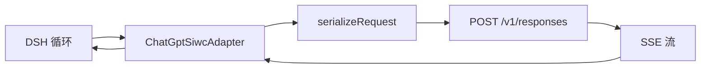

<!--
wiki:
  lang: zh-CN
  translation_of: WIKI.md
  source_sha256: d8e8ca1d582e76802e84a98950f21bede9801b106a13c460937ba08bff8a1632   # sha256 of WIKI.md body at translation time; mismatch = stale
  source_commit: 02013f245d5b8395ac5164ca4d4e9f57932317ac
  publish_as: Home-zh-CN.md
  rc5_note: 关于 0.2.1-rc.5 + session-id 补丁的事实是对 siwc-rc5-session-id.zip（md5 c82d2197bad82455dd0e4c45193b6b8a）验证的，不是针对已推送的提交——rc.5 尚未推送或发布（见“状态与路线图”）。
Translate prose and table text. Keep code, commands, paths, keys, and numbers unchanged.
If source_sha256 no longer matches WIKI.md, put the stale banner at the top until re-translated.
-->
<!-- STALE BANNER (use only when stale): > 本页翻译落后于英文版，以 [English](WIKI.md) 为准。 -->


# dsh-chatgpt-siwc

[English](WIKI.md) | **简体中文**

一个 DeepSeek Harness（DSH）插件，让你用自己的 ChatGPT Plus/Pro 套餐，通过官方 Sign in with ChatGPT（SIWC）流程提供模型调用：先动态 OAuth 注册，再用签发的 OAuth 访问令牌调用公开 Responses API。它面向想把自己的 ChatGPT 订阅——而不是 API 密钥，也不是 Codex 登录——作为 DSH 内提供方的 DSH 用户。它和同类插件不一样的地方在于：它把套餐路由当作要用代码强制执行的契约，而不是凭感觉——实时模型发现，不用静态列表；按模型的推理力度取自目录；提示缓存行为是确定性的（`session-id` 请求头与 `prompt_cache_key` 携带相同的值、系统提示不再在对话中途重写自己、加密推理会被重放而不是重新推理）。

| | |
| --- | --- |
| 状态 | Alpha，截至 0.2.1-rc.5 + session-id 补丁（2026-11-11，仅 tarball，未发布；见“状态与路线图”） |
| 语言 / 运行时 | TypeScript，Node `^22.19.0 \|\| >=24.0.0`，DSH 宿主 `>=0.2.2-rc.1 <0.3.0`（`package.json`） |
| 许可 | MIT |
| 最新发布 | [v0.2.1-rc.3](https://github.com/calisweetleaf/dsh-chatgpt-swic/releases/tag/v0.2.1-rc.3)（2026-11-09；稳定版是 [v1.0.0](https://github.com/calisweetleaf/dsh-chatgpt-swic/releases/tag/v1.0.0)） |
| npm | [dsh-chatgpt-siwc](https://www.npmjs.com/package/dsh-chatgpt-siwc)——最新版 2.0.1（2026-11-10），**不包含** rc.5 的缓存修复 |
| 仓库 | [calisweetleaf/dsh-chatgpt-swic](https://github.com/calisweetleaf/dsh-chatgpt-swic)（1 star，0 forks，2026-11-11） |

## 目录

按问题查找对应章节。

1. [为什么要做](#为什么要做)
2. [工作原理](#工作原理)
3. [组件](#组件)
4. [安装](#安装)
5. [使用](#使用)
6. [配置](#配置)
7. [结果与证据](#结果与证据)
8. [API 参考](#api-参考)
9. [状态与路线图](#状态与路线图)
10. [参与贡献](#参与贡献)
11. [更新日志](#更新日志)
12. [许可与引用](#许可与引用)
13. [术语表](#术语表)

## 为什么要做

DSH 是一个宿主框架，不提供模型。要在 DSH 里用 ChatGPT 模型，你需要一个提供方：一边讲宿主的 LLM 契约，一边讲 OpenAI 的 API——用的是用户已经付费的账户。官方 SIWC 流程正是为此存在的（动态 OAuth 注册，再调用公开 Responses API），但显而易见的接法都在花钱或正确性上走了捷径。

这个插件正是针对这些故障模式而建的：

| 问题 | 常见做法 | dsh-chatgpt-siwc 的做法 | 证据 |
| --- | --- | --- | --- |
| 套餐路由悄悄烧掉 token | 只在请求体里发 `prompt_cache_key`，以为后端会按它路由 | 同时发一个携带相同值的 `session-id` 请求头，因为后端是按请求头、而不是按请求体键来固定缓存亲和性的 | `src/adapter.ts`（rc.5+补丁新增 4 行）；`codex-rs/core/src/client.rs:734`（“ChatGPT derives cache affinity from the Responses session-id header”）；[Kogen Bench](https://bench.kogen.dev/rounds/chatgpt-session-cache-1/)：仅请求体键时 6/6 次缓存为 0.00，加 `session_id` 请求头后 6/6 次为 0.91–0.98 |
| 系统提示每轮重写自己，缓存全废 | 把每条系统消息都折进 `instructions` | 声明 `systemPromptUpdate: 'in-history'`；只有开头的系统消息成为 `instructions`，后面的在原位保留为 developer 消息 | `src/adapter.ts`（`resolveModel`）；`src/serialize.ts`；`tests/prompt-cache.test.ts`（“keeps a mid-conversation system prompt in place instead of rewriting instructions”） |
| 每次工具往返后模型都从头重新推理 | `store: false` 且不重放 | 请求 `reasoning.encrypted_content`，把已完成的推理项在工具调用前重放，按账户 + 模型做键 | `src/serialize.ts`（`replayKey`、`replayBlocksFor`）；`tests/prompt-cache.test.ts`（“round-trips encrypted reasoning through the host assembler and replays it before the tool call”） |
| 静态模型列表会过时；推理力度选项是编出来的 | 写死模型和力度 | 按账户实时调用 `GET /v1/models`，本地缓存，离线时回退缓存；力度取自目录条目，绝不编造 | `src/oauth.ts`（`fetchModels`、`modelCatalogEndpoint`）；`src/index.ts`（`registerModelDiscovery`）；`README.md`（“Model index and reasoning”） |
| 登录不等于授权 | 登录成功就当作可以花钱 | 授予的 `chatgpt.tokens.use.direct` 作用域才是用量开关；只登录什么也启用不了 | `src/oauth.ts`；`src/store.ts`；`README.md`（“Plan usage is a grant, not an identity”） |
| 别的插件借用 Codex 认证或共享 token | 用 `~/.codex/auth.json`、共享 token 服务、sub2api | 只走 SIWC 公开流程；一个账户的 client id 永远只和该账户的 token 一起走；不共享、不碰 Codex 端点 | `src/oauth.ts`；`src/api-origin.ts`；`README.md`（“Boundaries”） |

## 工作原理

```text
DSH 循环 -> adapter.stream() -> serializeRequest() -> POST /v1/responses（store:false，stream:true）
  -> SSE 流 -> adapter 翻译成块 -> 宿主块（文本 / 推理 / 工具调用 / 用量）
  -> 下一轮重放历史 + 加密推理，同一个 session-id 请求头
```



### 核心思想

序列化器用**省略**来强制执行套餐用量契约：请求只携带套餐路由允许的东西，路由禁止的任何东西都不会被发出——不是清洗，不是给默认值，就是不存在。在此之上，三种机制让缓存从碰运气变成确定性的：

```text
prompt_cache_key = sessionId                     （超过 64 字符时取 sha256）
session-id 请求头  = prompt_cache_key            （相同的值；后端按请求头路由亲和性）
replay key         = sha256(client_id, subject, model)[:32]
instructions       = 只有开头的系统消息（后面的成为原位 developer 消息）
```

其中：

- `sessionId`：这次对话的宿主会话 id（`GenerateOptions.sessionId`）。一个会话，一条缓存路由。
- `prompt_cache_key`：请求体中携带该 id 的 Responses 字段。单凭它对亲和性不起作用——上面的 Kogen 测量显示，只发请求体键时缓存为 0.00。
- `session-id`：携带相同值的 HTTP 请求头。后端按它路由。Codex 通过 `build_session_headers` 发它（`codex-rs/codex-api/src/requests/headers.rs`）；这个适配器也发它。
- `replay key`：存储的推理项在重放前必须匹配的身份——账户 + 模型，绝不包含 token 或邮箱。
- `in-history`：适配器声明的 `systemPromptUpdate`，告诉 DSH 把变化的系统提示追加到历史里，而不是重写消息 0——重写会让整个已缓存前缀失效。

登录的一半和模型调用的一半是分开的路径。登录是交互式 OAuth（动态注册、PKCE、本地回环回调、JWKS 验证 ID 令牌、跨进程锁下刷新）；模型调用从不碰登录流程，只用已存账户的访问令牌。

## 组件

### 适配器——`src/adapter.ts`

- **用途：**宿主 `LlmAdapter`：派发 Responses 请求，把 SSE 流翻译成宿主块。
- **位置：**`src/adapter.ts`（`ChatGptSiwcAdapter`）
- **输入 / 输出：**输入 `GenerateOptions`，输出宿主块的异步流（文本、推理、工具调用、用量）；错误为 `LlmError`。
- **关键行为：**
  - 有会话 id 时发与 `prompt_cache_key` 相等的 `session-id` 请求头；没有会话时不发（`tests/prompt-cache.test.ts`）。
  - 省略不可用的用量字段（条件展开）——宿主的流累加器会拒绝包含 `undefined` 的自有属性（`mapUsage`）。
  - 原样保留所选的推理力度；模型 / 力度组合不受支持时在上游失败，绝不悄悄降级。

```ts
...(body.prompt_cache_key !== undefined ? { 'session-id': body.prompt_cache_key } : {}),
```

### 序列化器——`src/serialize.ts`

- **用途：**构造 `POST /v1/responses` 的请求体，用省略强制执行套餐契约。
- **位置：**`src/serialize.ts`（`serializeRequest`、`promptCacheKey`、`replayKey`）
- **输入 / 输出：**输入 `GenerateOptions` + `{ reasoningEffort?、reasoningSummary?、replayKey? }`，输出 `ResponsesRequest`。
- **关键行为：**
  - 永远 `store: false`、`stream: true`。绝不发送 `max_output_tokens`、`temperature`、`top_p`、`prompt_cache_retention`、`truncation`、`metadata`、`user`。
  - 开头的系统消息成为 `instructions`；后面的成为原位 developer 消息。
  - 推理重放：力度不是 `none` 时请求 `include: ['reasoning.encrypted_content']`；已完成的推理项只在重放键匹配时才在工具调用前重新插入。
  - 图片和文件输入在本地以 `UNSUPPORTED_CONTENT` 拒绝，绝不悄悄丢弃。

```ts
serializeRequest(options, { reasoningEffort: 'high' })
// -> { model, instructions, input, tools?, reasoning: { effort: 'high', summary: 'auto' },
//      include: ['reasoning.encrypted_content'], prompt_cache_key, store: false, stream: true }
```

### OAuth 与账户——`src/oauth.ts`、`src/jwt.ts`、`src/store.ts`

- **用途：**SIWC 发现、动态注册、PKCE、回调、令牌刷新与账户持久化。
- **位置：**`src/oauth.ts`（`login`、`refreshAccount`、`fetchModels`、`modelCatalogEndpoint`）、`src/jwt.ts`、`src/store.ts`（`AccountsStore`）
- **输入 / 输出：**输入 OIDC 发现文档 + 用户授权，输出账户记录（client id、令牌、授予的作用域、模型索引），存放在 `chatgpt-siwc/accounts.json`（`0600`，目录 `0700`）+ 非机密的 `host.json`。
- **关键行为：**
  - 动态注册以 `client_id=dynamic_agent_client` 和宿主稳定的 `ext_agent_host_id` 开始；签发的 `oaiapp_…` client id 在兑换 code 之前就保存，所以重试会重新连接同一个应用，而不是在你的 ChatGPT 账户上再注册一个。
  - 在 token 端点用 `resource=https://api.openai.com/v1` 兑换 code，无 client secret；用 JWKS、签发方、受众、nonce 验证 ID 令牌。
  - 刷新在账户文件写锁内、重新读取记录后执行，并复用另一个进程已提交的轮换，而不是再次花掉刷新令牌。
  - 计划令牌只附加到 `https://api.openai.com` 或本地回环宿主（`src/api-origin.ts`），在配置时和每次 bearer 请求前都会检查。

### 模型发现——`src/oauth.ts` + `src/index.ts`

- **用途：**选择器显示账户实际能用的模型，实时获取，没有静态列表。
- **位置：**`src/oauth.ts`（`fetchModels`）、`src/index.ts`（`registerModelDiscovery`）
- **输入 / 输出：**输入计划令牌 + 端点，输出 `{ slug, displayName, reasoningEfforts }` 目录，按账户缓存，离线时回退缓存。
- **关键行为：**
  - 接受两种目录形态（订阅可见性目录和公开 API 数据数组目录）；遇到未知形态会报目录错误，而不是编造一个空结果。
  - 首次加载选择器时拉取；之后加载和切换模型时读本地索引，不刷新令牌也不查询目录。
  - `ultra` 只在模型声明时出现——已在界面上为 GPT-6.1 Terra 验证（见“结果与证据”）。实时 Ultra 推理尚未测试。

### CLI 与 doctor——`src/bin.ts`、`src/doctor.ts`

- **用途：**在模型调用路径之外做登录、状态、模型索引和诊断。按设计不含 token。
- **位置：**`src/bin.ts`、`src/doctor.ts`
- **输入 / 输出：**输入命令，输出人类可读文本或 JSON；没有任何命令会打印 token。
- **关键行为：**
  - `login [--no-browser] [--new]`、`doctor`、`status`、`models`、`logout [--purge]`、`help`。
  - `doctor` 打印不含 token 的 JSON：已加载的构建、账户文件、注册、锁、端口——每次安装后首先要检查的东西。
  - 人类可读输出为英文或简体中文（`--lang zh|en`，否则按 `LC_ALL` → `LC_MESSAGES` → `LANG`）；JSON、错误码、模型 slug 和 URL 永远不翻译。

```bash
dsh-chatgpt-siwc doctor
dsh-chatgpt-siwc status --lang zh
```

### 设置卡片（浏览器一半）——`src/client/`、`locale/`

- **用途：**DSH 网页客户端里的插件卡片：连接状态、套餐权限、登录、重新连接、取消、刷新、断开连接。
- **位置：**`src/client/`（`card.tsx`、`controller.ts`、`locales.ts`）、`locale/en.json`、`locale/zh.json`、`docs/DETAIL.md`、`docs/DETAIL.zh.md`
- **输入 / 输出：**输入宿主语言 + `siwcAccount` Typert 远程，输出渲染出的卡片；远程只返回身份和套餐事实，绝不返回 token 材料。
- **关键行为：**
  - `zh` 和 `en` 词典携带相同的键集合（类型强制）；卡片用当前宿主语言渲染错误。
  - 登录中途停住时，卡片会说出停在哪一步，并给出机器码；宿主日志里有同一行。
  - 每个语言的 `meta.detail` 指向一个打包好的 Markdown 文档（英文 `docs/DETAIL.md`、中文 `docs/DETAIL.zh.md`）——DSH 插件详情面板要求这样。

## 安装

**前置条件：**Node `^22.19.0 || >=24.0.0`，DeepSeek Harness `>=0.2.2-rc.1 <0.3.0`。运行插件的机器必须能通过 HTTPS 访问 `auth.openai.com`（发现、token、JWKS）和 `api.openai.com`（模型、Responses）；登录用的浏览器必须和 DSH 在同一台机器上（本地回环回调在 `127.0.0.1` 上）。

**从网页客户端安装：**插件 → 按包名、Git URL、tarball 或本地路径安装 → DSH 要求时重启 → 打开插件卡片 → **使用 ChatGPT 登录**。

**从终端安装**（profile 必须放在 pnpm 参数之前）：

```bash
dsh plugin --profile web add dsh-chatgpt-siwc            # npm（2.0.1——不含 rc.5 缓存修复）
dsh plugin --profile web add ./dsh-chatgpt-siwc-<ver>.tgz  # 打包好的 tarball（rc.5 + session-id 补丁只有 tarball）
```

安装打包好的 tarball 或 npm 包，不要装源码目录：已发布的 `lib/` 在宿主上不需要构建步骤。Node 模块路径上别处的旧副本（比如某个祖先 `node_modules` 里的旧软链接）可能会遮住已安装的版本；插件在启动时记录 `dsh-chatgpt-siwc <version> loaded from <path>`，`dsh-chatgpt-siwc doctor` 也会打印同样的信息，所以每次安装后都要检查。

开发安装：

```bash
git clone https://github.com/calisweetleaf/dsh-chatgpt-swic.git
cd dsh-chatgpt-swic
npm ci
npm run typecheck
npm test
```

检查是否装好：

```bash
dsh-chatgpt-siwc doctor   # 应输出不含 token 的 JSON：已加载的构建、账户文件、注册、锁、端口
npm pack --dry-run         # 0.2.1-rc.5 + session-id 补丁应为 97 个文件
```

## 使用

### 快速上手

1. 按上面安装，DSH 要求时重启。
2. 打开插件卡片并使用 ChatGPT 登录——或在终端运行 `dsh-chatgpt-siwc login`。
3. 在 DSH 里选模型。首次加载选择器时会拉取账户目录；之后加载读本地索引。
4. 开始对话。看用量行：每次请求都会报告缓存的 token 数（用量块里的 `cacheReadTokens`）。

### 常见任务

| 你想做 | 运行 / 调用 | 说明 |
| --- | --- | --- |
| 登录 | 卡片 → **使用 ChatGPT 登录**，或 `dsh-chatgpt-siwc login` | 交互式；浏览器和 DSH 必须在同一台机器上 |
| 检查是否已登录 | `dsh-chatgpt-siwc status` | 不含 token 的账户公开视图 |
| 重建模型索引 | `dsh-chatgpt-siwc models` | 打印模型 ID、名称、声明的力度 ID；不打印凭证 |
| 检查加载的是哪个构建 | `dsh-chatgpt-siwc doctor` | 每次安装后首先检查；同时打印加载路径 |
| 退出登录 | 卡片 → 断开连接，或 `dsh-chatgpt-siwc logout` | 在发现文档的撤销端点撤销，再清除本地令牌；`--purge` 删除账户记录 |
| 看登录停在哪一步 | 卡片错误行或宿主日志 | 说出步骤 + 机器码（例如 *exchanging the approval for access*） |
| 改推理力度 | 在 DSH 里选，或在配置里设 `reasoningEffort` | 按所选发送；缓存目录不包含时会被拒绝——绝不悄悄降级 |

## 配置

| 键 | 默认值 | 作用 | 定义位置 |
| --- | --- | --- | --- |
| `provider` | `siwc-dsh-core` | 插件注册的提供方路由 id；改名会原子化地重新注册路由 | `cordis.patch.yml`；`src/index.ts` |
| `agentNameHint` | `DSH SIWC` | 动态注册时向 ChatGPT 显示的名字 | `cordis.patch.yml`；`src/index.ts` |
| `apiBaseUrl` | `https://api.openai.com` | 只接受 `https://api.openai.com` 或本地回环宿主 | `src/index.ts`；`src/api-origin.ts` |
| `reasoningEffort` | 未设置 | 设置后作为 Responses 的 `reasoning.effort` 发送；模型 / 力度组合不受支持时在上游失败 | `src/index.ts`；`src/serialize.ts`（`EFFORT_MAP` 原样保留所选力度） |
| `storePath` | 宿主目录下的 `chatgpt-siwc/accounts.json` | 账户文件覆盖 | `src/index.ts`；`src/store.ts` |
| `streamIdleTimeoutMs` | `120000` | Responses 流的字节空闲看门狗；接受心跳流量 | `src/index.ts`；`src/adapter.ts` |

配置字段是易变的：提交的改动无需重启即生效。人类可读 CLI 输出的语言不是配置键：`--lang zh|en`，否则按 `LC_ALL` → `LC_MESSAGES` → `LANG`（`zh_*` 选中文）。

## 结果与证据

只报告实测结果。尚未测量的都明确标注——这里没有任何没有出处的数字。

| 指标 | 数值 | 环境 | 复现 |
| --- | --- | --- | --- |
| 测试 | 301 / 301 通过，17 个文件 | 0.2.1-rc.5 + session-id 补丁，Node 24，本仓库 2026-11-10 的运行 | `npm ci && npm test` |
| 类型检查 | 退出码 0（服务端 + 客户端） | 与上面同一轮运行 | `npm run typecheck` |
| 打包 | 97 个文件 | 对 0.2.1-rc.5 + session-id 补丁运行 `npm pack --dry-run` | `npm pack --dry-run` |
| CI | main `02013f2` 上成功，Node 22 + 24 | GitHub Actions，push 事件，2026-11-10T10:10:28Z，运行 `.github/workflows/ci.yml`（checkout → setup-node → `npm ci` → 类型检查 → `npm test` → `npm pack --dry-run`） | [Actions 运行记录](https://github.com/calisweetleaf/dsh-chatgpt-swic/actions) |
| 提示缓存亲和性，独立基准 | 仅请求体 `prompt_cache_key`：6/6 次缓存为 0.00。加 `session_id` 请求头：6/6 次为 0.91–0.98，两个模型。一旦有了请求头，请求体键就没有可测量的差别 | Kogen Bench 回合 `chatgpt-session-cache-1`，在 ChatGPT 订阅 Responses 路由（`api.openai.com/v1/responses`）上的合成 8 轮对话——与本插件用的路由相同 | [bench.kogen.dev](https://bench.kogen.dev/rounds/chatgpt-session-cache-1/) |
| 本插件实时的提示缓存命中率 | **尚未测量** | rc.5 + session-id 补丁还没有跑过一次实时对话 | 安装 rc.5 tarball，跑一个会话，按请求读 `cached_tokens` |
| 选择器里的 Ultra | 原生力度选择器为 GPT-6.1 Terra 显示了 Ultra | 2026-11-09 的实时 DSH 界面检查 | v0.2.1-rc.3 发布说明（“the native picker showed Ultra for GPT-6.1 Terra”） |
| 实时 Ultra 推理 | **未测试** | — | — |
| 计划令牌接受 `include` + `prompt_cache_key` | **未验证** | 唯一证据：pi-ai 同时发这两个字段；`CONTEXT.md`（rc.5 一节）说如果 API 在首轮返回 400，先去掉 `include` | — |

## API 参考

公开接口是 Cordis 注册、CLI 和序列化器。未列出的都是内部实现，可能会变。

### Cordis 打包注册

`package.json`（`dsh.bundle.patch`）指向 `cordis.patch.yml`，它插入一行：

```yaml
- insert:
    - id: dsh-chatgpt-siwc
      name: dsh-chatgpt-siwc
      config:
        provider: siwc-dsh-core
        agentNameHint: DSH SIWC
```

补丁行 id 永远等于 npm 包名。安装和 Cordis 配置是两个独立的操作；把它们混为一谈是本仓库自己历史里记录的架构错误。

### CLI——`dsh-chatgpt-siwc`

```bash
dsh-chatgpt-siwc login [--no-browser] [--new]
dsh-chatgpt-siwc doctor
dsh-chatgpt-siwc status
dsh-chatgpt-siwc models
dsh-chatgpt-siwc logout [--purge]
dsh-chatgpt-siwc help
```

| 命令 | 含义 |
| --- | --- |
| `login` | 交互式 SIWC 登录；除非 `--new`，否则复用本机的注册；`--no-browser` 改为打印 URL |
| `doctor` | 不含 token 的 JSON 诊断：已加载的构建 + 路径、账户文件、注册、锁、端口 |
| `status` | 不含 token 的账户公开视图 |
| `models` | 重建账户索引；打印模型 ID、名称、声明的力度 ID |
| `logout` | 撤销，再清除本地令牌；`--purge` 删除账户记录 |

返回人类可读文本或 JSON。绝不打印 token。`--lang zh|en` 选择人类可读语言。

### `serializeRequest(options, defaults?)`

```ts
serializeRequest(
  options: GenerateOptions,
  defaults?: { reasoningEffort?: string; reasoningSummary?: boolean; replayKey?: string },
): ResponsesRequest
```

| 参数 | 类型 | 默认值 | 含义 |
| --- | --- | --- | --- |
| `options` | `GenerateOptions` | — | 宿主生成选项：`system`、`messages`、`tools`、`sessionId`、`model` |
| `defaults.reasoningEffort` | `string` | 未设置 | 所选的 Responses 力度，原样保留 |
| `defaults.reasoningSummary` | `boolean` | 除非力度为 `none`，否则为 `true` | 是否请求 `reasoning.summary: 'auto'` |
| `defaults.replayKey` | `string` | 未设置 | `replayKey(clientId, subject, model)`；只有存储项的键匹配时才重放推理 |

返回 `POST /v1/responses` 的请求体（`model`、`instructions`、`input`、`tools?`、`reasoning?`、`include?`、`prompt_cache_key?`、`store: false`、`stream: true`）。图片 / 文件输入会以 `LlmError`（码 `UNSUPPORTED_CONTENT`）抛出。定义在 `src/serialize.ts`。

### `promptCacheKey(sessionId)` / `replayKey(clientId, subject, model)`

```ts
promptCacheKey(sessionId: string): string  // 会话 id 原样；超过 64 字符时取 sha256
replayKey(clientId: string, subject: string, model: string): string  // sha256([clientId, subject, model]).slice(0, 32)
```

两个值都不含 token 或邮箱。定义在 `src/serialize.ts`。

## 状态与路线图

| 领域 | 状态 | 说明 |
| --- | --- | --- |
| SIWC 登录（动态注册、PKCE、JWKS、刷新） | 可用 | 操作者报告 + `tests/oauth.test.ts`、`tests/login-recovery.test.ts`；实时登录是操作者步骤，绝不是自动化测试 |
| 模型发现（实时 `/v1/models`，按账户缓存） | 可用 | `src/oauth.ts`（`fetchModels`）；`tests/oauth.test.ts` |
| 选择器里的按模型力度 | 可用 | 原生选择器为 GPT-6.1 Terra 显示了 Ultra（v0.2.1-rc.3 发布说明） |
| 提示缓存（键 + 请求头 + in-history + 重放） | 部分 | 代码已验证：301/301 测试，包括经过宿主自己的 `AssistantStreamAccumulator` + `BlockAssembler` 的往返。实时命中率未测量；计划令牌接受 `include` + `prompt_cache_key` 未验证 |
| 实时 Ultra 推理 | 未测试 | — |
| 网页 profile 上的账户登录 | 未完成 | 2026-11-10 的最新截图里卡片仍显示 未连接 |
| rc.5 修复的 npm 发布 | 计划中 | npm 最新版 2.0.1（2026-11-10 11:02 UTC）的键未哈希，没有 in-history 处理，没有推理重放 |
| 仓库改名 `swic` → `siwc` | 计划中 | `package.json` 的 repository/bugs 指向 `github.com/calisweetleaf/dsh-chatgpt-siwc`，返回 404；仓库仍是 `dsh-chatgpt-swic` |
| 注册表收录（dsh.pub、dsh-plugin.com、dsh.so、awesome 列表） | 计划中 | 截至 2026-11-10 未在任何地方收录；工作区里已有发现包草稿 |
| 图片 / 文件输入、托管工具 | 不计划 | 按设计在本地拒绝（`UNSUPPORTED_CONTENT`）；托管工具在套餐路由上不受支持 |

已知限制：

- `store: false` 意味着每次请求都会重新发送完整对话历史；缓存是让这件事负担得起的东西，而实时命中率仍未测量。
- 完整工具 schema 每次请求都会重新发送，宿主循环每次请求还会注入上下文（time-context、runtime-context、技能目录）。如果其中任何东西落在已缓存前缀里，命中率都会下降，适配器做什么都没用——决定性的测试是把同一轮里的两个连续请求做字节对比，尚未在实时环境跑过。
- 推理项发送时不带 `id`（见 `CONTEXT.md` rc.5 一节）。
- 持有 `accounts.json.lock` 的进程被杀死后会留下孤儿锁，阻塞写者，直到手动删除（dsh-atomic-write 策略；`CONTEXT.md` 安全一节）。
- 仓库上有两个中等的 Dependabot 告警（具体是哪些依赖尚未核查）。

下一步：

- 把 rc.5 + session-id 补丁的 tarball 装进 DSH，跑第一次实时对话（目标：现在）。如果首轮返回 400，先去掉 `include`。
- 在一个会话里按请求测量 `cached_tokens`；把同一轮里的两个连续请求做字节对比（目标：第一次实时会话）。
- 发布 rc.5 这条线，把仓库从 `swic` 改名为 `siwc`（目标：第一次实时会话证明缓存之后）。
- 注册表收录和双语发布说明（目标：发布之后）。

## 参与贡献

1. 先读 `AGENTS.md`——它是工作路由器（工作道、归属、硬边界、验证）。注意它的头部状态截至 2026-11-11 已过时（它写的是 0.1.0 版、HEAD `9c8c7d6`、没有观测到托管 CI 运行）；实时状态以本页和 `CONTEXT.md` 为准。如果路由器与实时代码或测试冲突，以代码为准，并把差异写进工作报告。
2. 改行为之前先读 `CONTEXT.md`，了解最新简明状态。
3. 从 `main` 分支。仓库里没有强制的分支命名约定。
4. 推送前跑门禁——每次 pull request 和每次 `main` 推送，CI 都会在 Node 22 和 24 上跑同样的四项（`.github/workflows/ci.yml`）：

```bash
npm ci
npm run typecheck
npm test
npm pack --dry-run
```

5. 开 pull request。仓库里还没有 issue/PR 模板（`.github/` 里只有 `workflows/`），所以直接开普通 issue，把测试输出贴进 PR 描述。

硬边界（来自 `AGENTS.md`——PR 里不可协商）：

- 只走 SIWC 公开 Responses API。绝不碰 `~/.codex/auth.json`、Codex 后端端点、Codex 应用凭证、共享或共用 token。
- 登录成功不等于授权：授予的 `chatgpt.tokens.use.direct` 作用域才是用量开关。
- token 和机密不进日志、CLI 输出、测试、文档、提交和公开制品。不要把真实 OAuth 登录或撤销账户当作测试来跑。
- `lib/` 是从 `src/` 生成的——改 `src/`，再构建。不要手工改生成产物。
- 未经操作者对该操作明确同意，不要发布、推送、发版或改动外部 GitHub 状态。

## 更新日志

仓库里没有 `CHANGELOG.md`；完整历史见 [GitHub 发布页](https://github.com/calisweetleaf/dsh-chatgpt-swic/releases)。

| 版本 | 日期 | 要点 |
| --- | --- | --- |
| 0.2.1-rc.5 + session-id 补丁 | 2026-11-10 | 提示缓存 + 推理重放 + `session-id` 请求头；301/301 测试；仅 tarball，未推送或发布 |
| 2.0.1（npm） | 2026-11-10 | 发布到 npm；**不包含** rc.5 缓存修复 |
| 2.0.0（npm） | 2026-11-10 | 发布到 npm |
| v0.2.1-rc.3 | 2026-11-09 | 详情面板打包修复（`meta.detail` 改为文件路径）；原生选择器为 GPT-6.1 Terra 显示了 Ultra；实时 Ultra 推理未测试 |
| v1.0.0 | 2026-11-08 | 正式公开版 |

## 许可与引用

按 MIT 许可。见 [LICENSE](https://github.com/calisweetleaf/dsh-chatgpt-swic/blob/main/LICENSE)。

目前没有 `CITATION.cff`，也没有 DOI，所以直接引用仓库：

```bibtex
@software{dsh-chatgpt-siwc,
  author  = {calisweetleaf},
  title   = {dsh-chatgpt-siwc},
  version = {0.2.1-rc.5},
  year    = {2026},
  url     = {https://github.com/calisweetleaf/dsh-chatgpt-swic}
}
```

## 术语表

| 术语 | 含义 |
| --- | --- |
| SIWC | Sign in with ChatGPT——OpenAI 的开源 OAuth 流程，让用户的 ChatGPT 套餐授权给一个应用 |
| DSH | DeepSeek Harness——本插件运行的宿主 |
| Cordis | DSH 所基于的插件框架；本包是一个 Cordis 插件，通过 `cordis.patch.yml` 注册 |
| `prompt_cache_key` | 请求体中携带会话 id 的 Responses 字段，用于提示缓存路由 |
| `session-id` 请求头 | 携带与 `prompt_cache_key` 相同值的 HTTP 请求头；后端按这个请求头固定缓存亲和性 |
| 缓存亲和性 | 后端把一个会话的请求路由到同一缓存；没有它，即使前缀稳定也会错过缓存 |
| `systemPromptUpdate: 'in-history'` | 适配器的声明：变化的系统提示追加到历史里，而不是重写消息 0 |
| `replayState` | 消息上适配器私有的推理数据（`{v:1, key}` + 按块条目），只有键匹配时才重放 |
| 套餐作用域开关 | 模型调用需要授予的 `chatgpt.tokens.use.direct` 作用域——只登录不是授权 |
| 单应用上限 | 用户在 ChatGPT 设置（管理用量）里管理的按应用用量上限 |
| 本地回环 | 接收 OAuth 回调的 `127.0.0.1` 监听器；浏览器和 DSH 必须在同一台机器上 |
| Doctor | `dsh-chatgpt-siwc doctor` 命令：不含 token 的 JSON 诊断，检查已加载的构建 |
| 推理力度 | 推理力度级别（`minimal`、`low`、`medium`、`high`、`xhigh`、`max`，声明时还有 `ultra`），取自模型的目录条目 |
| 提供方路由 | 插件在 DSH 里注册的 LLM 路由 id（`siwc-dsh-core`） |

---

<sub>事实核对自提交 `02013f245d5b8395ac5164ca4d4e9f57932317ac`（2026-11-11），以及对 `siwc-rc5-session-id.zip`（md5 `c82d2197bad82455dd0e4c45193b6b8a`）验证的 0.2.1-rc.5 + session-id 补丁。英文原文：[English](WIKI.md)。</sub>
